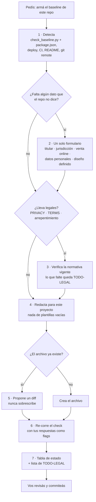

# repo-baseline

**Que todo repo nazca con su documentación mínima, escrita para ese proyecto.**

[English below](#english)

Skill para Claude Code y claude.ai. Deja cualquier repo, sitio o software con su set básico de documentación. No usa plantillas con `TODO: describir el proyecto`: los documentos salen de lo que el propio repo dice de sí mismo.

## Inicio rápido

```bash
npx skills add PapiScholz/repo-baseline -g      # 1. instalar (una sola vez por máquina)
```

2. **Abrí Claude Code en el repo** y pedí: *"armá el baseline de este repo"*, o escribí `/repo-baseline`.
3. **Contestá el formulario**, si aparece. Solo pregunta lo que no pudo deducir del repo, todo junto, en hasta 4 preguntas.
4. **Revisá lo que te deja:**
   - los archivos creados;
   - los diffs propuestos para los que ya existían;
   - la tabla de estado;
   - la lista de `TODO-LEGAL` para pasarle al contador o al cliente.
5. **Commiteá vos.** La skill nunca toca git.

¿Solo querés saber qué le falta a un repo? Pedí *"revisá el baseline de este repo"*: corre el check y te muestra la tabla sin escribir nada.

## Qué deja

| Archivo | Cuándo |
|---|---|
| `README.md` y READMEs por carpeta con reglas propias | Siempre |
| `ARCHITECTURE.md` | Siempre |
| `docs/adr/0000-template.md` + `0001-<decisión>.md` | Siempre |
| `DESIGN.md` (formato google-labs-code/design.md) | Si el diseño UX/UI está definido; si no, queda anotado como pendiente en el README |
| `PRIVACY.md` | Si maneja datos personales |
| `TERMS.md` | Si hay usuarios finales o venta |
| Botón de arrepentimiento | Si vende online en Argentina (requisito de UI, no solo de docs) |
| `SECURITY.md`, `LICENSE.md`, `.gitignore`, `.gitattributes`, `.editorconfig` | Siempre |
| `CONTRIBUTING.md`, `CODE_OF_CONDUCT.md` (texto oficial del Contributor Covenant), plantillas de issues y PRs | Si el repo es público u open source |
| `CHANGELOG.md` (Keep a Changelog) | Si publica versiones |
| `CODEOWNERS` | Si hay más de un mantenedor |
| Reporte privado de vulnerabilidades | Si es público en GitHub: queda como pendiente, con el comando para activarlo |

## Flujo



1. **Detecta antes de preguntar.**
   - Corre `check_baseline.py`, que viene dentro de la skill (Apéndice D) y solo usa la biblioteca estándar de Python. Lo escribe en un directorio temporal, fuera del repo.
   - Lee `package.json`, `pyproject.toml`, las configs de deploy, el CI, el README existente y `git remote -v`.
   - De ahí saca el stack, qué falta y señales como pagos, auth o formularios.
2. **Pregunta solo lo que no pudo deducir**, todo en un formulario:
   - el titular del código;
   - la jurisdicción (Argentina por defecto, pero siempre se confirma);
   - si vende online;
   - si maneja datos personales;
   - si el diseño está definido.

   Si una señal ya responde algo, como `mercadopago` en las dependencias, lo ofrece preseleccionado.
3. **Verifica la normativa vigente** antes de escribir legales. Los datos del titular que exige la ley y no le diste quedan marcados `TODO-LEGAL`.
4. **Redacta para el proyecto.** Las decisiones no se inventan: el ADR 0001 sale de la evidencia del repo, y lo que propone sin confirmar queda marcado `(sugerido — confirmar)`.
5. **Archivos existentes: diff, nunca sobrescribe.**
6. **Verifica.** Corre el check otra vez, pasándole tus respuestas como flags para que no adivine.
7. **Cierra con una tabla.** Cada archivo queda como `creado`, `actualizado`, `diff propuesto`, `pendiente` o `no aplica`, y abajo va la lista consolidada de `TODO-LEGAL`.

**Límites:** no hace operaciones de git, no instala dependencias, no toca ni audita el código de la app y no borra archivos.

## Dónde vive la versión buena

**Este repo es la fuente de verdad.** Si la skill está instalada en varios lados (Claude Code local, claude.ai), las ediciones se hacen acá y después se copian a cada uno:

```bash
python tools/drift.py
```

Compara este `SKILL.md` con cada copia instalada, incluida la que sincroniza claude.ai, y te dice cuál quedó distinta y cómo alinearla. Para actualizar claude.ai: Configuración → Capacidades → Skills → reemplazar con el `SKILL.md` de este repo.

## Instalación

| Dónde | Cómo |
|---|---|
| Claude Code ([skills CLI](https://skills.sh)) | `npx skills add PapiScholz/repo-baseline -g` |
| Claude Code, a mano | Copiar `SKILL.md` a `~/.claude/skills/repo-baseline/SKILL.md` |
| claude.ai | Configuración → Capacidades → Skills → subir `SKILL.md` |

## Tests

```bash
python -m unittest discover tests
```

- La skill le pide al agente que copie `check_baseline.py` tal cual desde el Apéndice D. Si ese bloque se rompe, la skill falla en silencio. Por eso los tests lo extraen de `SKILL.md` y lo corren contra repos de prueba: vacío, con README casi vacío, completo y con stack Node. Se verificó metiendo un error de sintaxis en el bloque: todos los tests dieron rojo.
- Otros casos: un repo con licencia MIT pide los archivos de comunidad y uno con `--no-public` no; `CHANGELOG.md` solo se pide si el repo publica versiones; `actions/checkout` no cuenta como señal de pagos, y `docs/ARCHITECTURE.md` cuenta como ARCHITECTURE.
- Otro test verifica que `tools/drift.py` detecte una copia desviada.

## Licencia

MIT

---

## English

A Claude Code / claude.ai skill that gives any repository its minimum documentation, written for that project:

- README, ARCHITECTURE and ADRs;
- DESIGN, when the UI is defined;
- SECURITY, LICENSE, `.gitignore`, `.gitattributes` and `.editorconfig`;
- for public / open source repos: CONTRIBUTING, CODE_OF_CONDUCT (the official Contributor Covenant text, downloaded), issue and PR templates; CHANGELOG when the project publishes versions;
- privacy and terms where they apply. Argentina is the default jurisdiction, always confirmed; a generic template covers others.

**Quick start:** `npx skills add PapiScholz/repo-baseline -g`, then ask Claude to "set up the baseline for this repo". It reads the repo before asking anything, asks the rest in a single form, never overwrites existing files (it proposes diffs) and ends with a status table. The skill text is in Spanish. The flow is in the diagram above.
